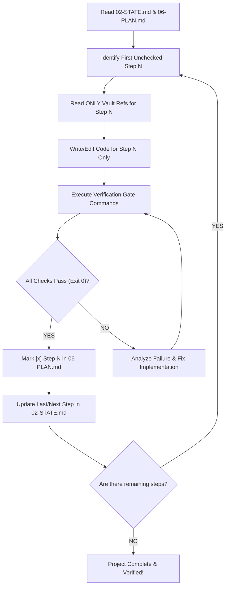

# Master Router Hub & Autonomous Execution Protocol
> **Context Architecture Vault System**  
> *Enforcing Zero-Hallucination, Step-by-Step Autonomous Engineering*

---

## 1. Vault Map (Read On-Demand Only)
Do NOT read all vault files at once. Read ONLY the specific file required by the current active step in `vault/06-PLAN.md`.

- **`vault/01-PRD.md`** : Product requirements, user stories, explicit out-of-scope boundaries, non-negotiables.
- **`vault/02-STATE.md`** : Active execution state machine, current checkpoint, blockers, completed steps log.
- **`vault/03-TOKENS.md`** : Design system, hex colors, typography scale, spacing units, system-wide constants.
- **`vault/04-STACK.md`** : Runtime, framework versions, pinned dependencies, forbidden libraries, test & build commands.
- **`vault/05-SCHEMA.md`** : Database tables, SQL/ORM definitions, TypeScript/Zod interfaces, API request/response contracts.
- **`vault/06-PLAN.md`** : The sequential atomic execution plan with explicit per-step verification gates.

---

## 2. Non-Negotiable Anti-Vibe-Coding Rules
1. **Never Assume or Guess:** If an API payload, schema column, or color is not defined in `vault/`, consult the corresponding vault file or stop and ask.
2. **One Step at a Time (Atomic Execution):** Implement ONLY the current unchecked step (`- [ ] Step N`). Modifying files or writing code for future steps (`Step N+1`) is strictly forbidden.
3. **No Skip Without Pass:** You must NEVER mark a step complete (`- [x]`) without executing its exact `Verification Gate` and observing exit code 0 with all assertions passing.
4. **No Mocking Away Real Errors:** If a test or typecheck fails, fix the underlying implementation. Never delete, comment out, or relax test assertions to make a gate pass.
5. **Context Economy:** Keep turn context small. View only specific lines of code using targeted line ranges; never dump entire directories or giant files.

---

## 3. Autonomous Execution Loop (Step -> Test -> Pass -> Next)
When instructed to run or continue this project (e.g., via `/goal` or "পরের স্টেপ করো"):



### Execution Protocol:
1. **Locate Step:** Read `vault/02-STATE.md` and `vault/06-PLAN.md`. Find the first unchecked item: `- [ ] Step N`.
2. **Load Target Docs:** Read only the files listed under `Vault Refs` of `Step N`.
3. **Implement:** Write or edit only the files listed under `Target Files`.
4. **Test:** Run the command(s) specified in `Verification Gate`.
5. **Verify:**
   - **If PASS (Exit 0):**
     1. Mark `- [x] Step N: ...` in `vault/06-PLAN.md`.
     2. Update `vault/02-STATE.md` (set `Last Completed Step = Step N`, `Active Step = Step N+1`).
     3. **GitHub Push (Mandatory after every passed step):**
        ```bash
        git add -A
        git commit -m "✅ Step N: <step title> — Verification Gate passed"
        git push origin main
        ```
     4. Proceed immediately to `Step N+1` without stopping, unless an explicit human checkpoint is required.
   - **If FAIL:**
     1. Do not proceed to `Step N+1`.
     2. Debug and patch the code (maximum 3 retry attempts).
     3. If still blocked, record the exact error in `vault/02-STATE.md` under `Active Blockers`, stop and notify the user.

